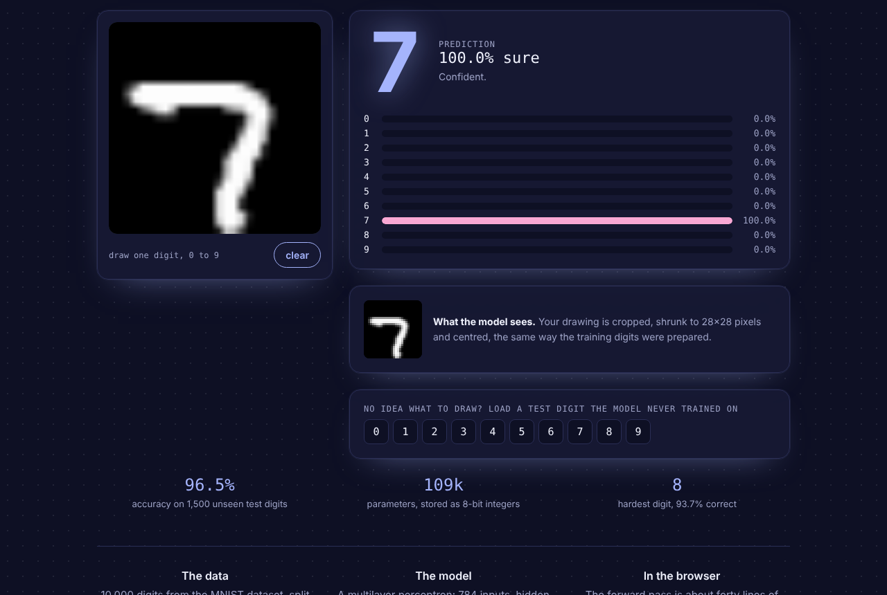

# Digit Reader

**Live demo: https://deeku46.github.io/digit-reader/**

Draw a digit from 0 to 9 and a neural network reads it live, in your browser. The network is a small multilayer perceptron trained on real MNIST handwriting, and its inference is written from scratch in about forty lines of JavaScript.



## Results (1,500 held-out MNIST digits)

| Metric | Score |
| --- | --- |
| Accuracy | **96.5%** |
| Accuracy after 8-bit compression | **96.5%** |
| Hardest digit | 8 (93.7% correct) |
| Parameters | 109k (about 110 KB as int8) |

## How it works

- **Data:** 10,000 MNIST digits from the MIT-licensed [`mnist`](https://www.npmjs.com/package/mnist) npm package. 8,500 are used for training and 1,500 are held out.
- **Augmentation:** each training digit gets three extra copies with random rotation (±14°), scaling and stroke thickening, giving 34,000 training images. This helps with mouse and finger drawings, which look different from scanned handwriting.
- **Preprocessing:** the same in training and in the browser. The digit is cropped to its bounding box, scaled to fit 20×20, placed in a 28×28 frame and centred by centre of mass, the way the original MNIST was prepared.
- **Model:** 784 → 128 → 64 → 10 MLP with ReLU and softmax, trained with Adam and early stopping in scikit-learn.
- **Compression:** weights are quantised to 8-bit integers with one scale per layer, with no loss of test accuracy.
- **Inference:** `index.html` decodes the weights and runs the forward pass (three matrix multiplications and a softmax) on every stroke. There's no ML library and no server.

## Retrain

```bash
pip install -r requirements.txt
npm pack mnist && tar xzf mnist-*.tgz          # gets the 10,000 digits as JSON
cd training
python train_digits.py ../package/src/digits   # writes ../model.js
python export_samples.py ../package/src/digits # writes ../samples.js
```

## Stack

Python · NumPy · SciPy · scikit-learn · vanilla JavaScript · Canvas

Built by [Deekshith P](https://deeku46.github.io/) · MIT licence
